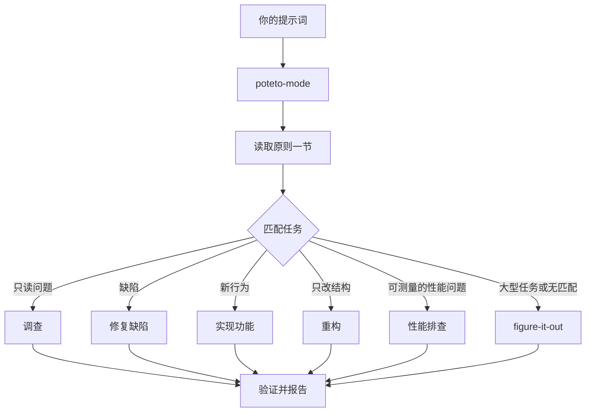

# 用 `/poteto-mode` 分派任务

`/poteto-mode` 接收目标，在 22 种 playbook 中匹配一个，把它的步骤复制到待办，再按步骤调用其他技能。下面说明好的提示词应包含什么，什么可以省略。


## 提示词如何变成工作



图里是常见路径。另有围绕单个指标持续改进、调查运行时症状或已有 trace、做原型、比对视觉一致性、编写和评估技能、自主执行、开 PR、跟进单个或堆叠 PR 到可合并、合并已验证的堆叠 PR、自动推进 PR 队列或堆叠、接续会话、安全暂停、多阶段计划和清理 worktree 的 playbook。完整清单见 [playbook 目录](../../skills/poteto-mode/playbooks/)。

## 直接说明目标

说明哪里出了问题、你要什么，并附上能省去调查的已知信息。

```text
/poteto-mode 重试后用户收到了两条通知。先复现，再修复并验证。
```

这会匹配 Bug fix playbook。「先复现」是实际约束，playbook 会遵守。你会看到待办列表填入 Bug fix 的步骤。

<a id="what-goes-in-a-prompt"></a>

## 提示词写哪些内容

实用的提示词最多包含五项，每项一句就够。

- **目标。** 说明哪里出了问题，或你想要什么。
- **完成检查。** 要能判定通过或失败。「做得更好」和「做一个小时」都无法用于检查。
- **想看到的证据。** 可以是真实命令输出、流程录像、存储值或前后对比数据。
- **已知信息。** 症状、复现步骤、一行日志或链接都能省下一轮搜索。
- **实际约束。** 「先复现」「先别改代码」「行为零变化」和「让我审阅后再继续」都会改变代理的做法。

下面的提示词包含全部五项。

```text
/poteto-mode 昨天发布后，CSV 导出漏掉最后一行。失败的任务 ID 是 4812。先复现，再修复。完成条件是导出测试样本的全部 6 万行。给我看修复前后的行数。
```

两项内容可以先省去。

- **具体做法。** 说清要实现什么，留出让代理寻找更好路径的空间。技能列表也一样，见本页末尾。
- **对成因的猜测。** 先听代理复述问题，再说你的推测。提前给出方向会收窄搜索范围。

遇到线索杂乱的报告，例如很长的讨论串或描述模糊的缺陷，把复述列为第一步。

```text
/poteto-mode 阅读这串讨论，用自己的话平实地复述根本问题。先别改代码。
```

这样能在写代码前看出误解。此时纠正只需一条消息。只需要复述时，运行 [`/in-your-own-words`](../../skills/in-your-own-words/SKILL.md)。它会说清代理理解的目标，以及你要解决的问题。

不确定提示词是否对准目标时，发送前先用 [`/sharpen`](../../skills/sharpen/SKILL.md) 改写。

```text
/sharpen 为 v2 配置格式写一份迁移指南。
```

代理会说明一流专业人士还会做什么、会从哪些原始材料入手、用什么方法和工具，以及有什么独立证据能证明结果正确。它会据此改写提示词，让任务做得更深，范围不扩大。改写会要求代理为可由实验判定的选择做原型，按结果推荐，并把产品和偏好选择留给你。你拿到的是改写后的提示词。看完后再发，例如交给 `/poteto-mode`。

## 简短跟进

聊天已经承载上下文时，以下任何一条都够。

```text
/poteto-mode 做吧
```

```text
继续
```

```text
继续，做到完成
```

playbook 保留结构，后续消息只需表达意图。想让 AGY 在本会话继续按 `/poteto-mode` 执行时，启动时写明。Cursor 的 Custom Mode 会在每轮保留该模式的上下文，见[运行第一项任务](./01-setup.md#run-your-first-task)。

## 用 “new task” 切换任务

长聊天会积累上一项任务的上下文。换主题时明确说出。

```text
/poteto-mode new task. 查明为什么退出登录后缓存条目还在。先别改代码。
```

“new task” 触发重新匹配。要求先别改代码会把这项工作路由到 Investigation。没有这些信息时，执行到一半的 Feature playbook 容易把问题当作下一步。

## 隔离并行任务的工作区

多代理在同一台机器上操作同一个工作区时，会争用文件、端口和构建输出。在 AGY 中，通过 `invoke_subagent` 按任务选 `Workspace: share` 或 `Workspace: branch` 做工作区隔离。外部角色由 `run_command` 后台调用 `scripts/multi-model-dispatch.sh`，为 `codex` 或 `pi` 各分配独立目录、端口和产物路径。可以混用 `agy:pro`、`agy:flash`、`agy:flash_lite`、`agy:inherit` 和外部模型，按[配置的角色](./01-setup.md#两条模型调度路径)选择。

上游 Cursor 的[云子代理](https://cursor.com/docs/subagents#cloud-subagents)用独立 VM 和分支隔离工作。它们能各自安装依赖、运行应用和录制结果，不占用你的计算机。使用该环境及获准的远程工作流时，可在任务前输入 `/in-cloud` 或让父会话分派到云子代理。

本地工作可在一开始就要求新建 worktree。

```text
/poteto-mode new task. 从 <基线> 在新的 worktree 建分支，把解析器改动移植过去。
```

各任务使用独立分支和 worktree，避免覆盖彼此文件。worktree 会占磁盘和机器资源，一台笔记本只能同时承担少量工作。[Opening a PR playbook](../../skills/poteto-mode/playbooks/opening-a-pr.md) 对代码变更已经从 worktree 开工，通常只需在基线或位置有要求时才指定。

worktree 会累积。磁盘吃紧时可以这样问。

```text
/poteto-mode 什么占了我的磁盘？清理可以安全移除的 worktree。
```

[Worktree cleanup playbook](../../skills/poteto-mode/playbooks/worktree-cleanup.md) 根据合并状态、未提交改动和仍在使用该目录的聊天分类。只删除证据确认可移除的目录。有未提交工作的目录留给你决定。

## 离开后让任务继续

说清完成条件，再离开。

```text
/poteto-mode im stepping away. 继续做到迁移检查报告旧调用方数量为零。记录你的决定。
```

日后需要回看的工作会路由到 [`/figure-it-out`](../../skills/figure-it-out/SKILL.md)。它设计运行阶段，并通过 [`/show-me-your-work`](../../skills/show-me-your-work/SKILL.md) 保留决策日志。AGY 可用 `schedule` 安排定时唤醒。完整的无人值守约定见[离开后继续运行](./07-overnight.md)。

**常见陷阱。** 避免在提示词里枚举技能，例如「先 `/architect`，再 `/arena`，然后 `/interrogate`」。playbook 已经安排顺序。手写列表通常会改顺序或漏掉步骤。只在要覆盖某个具体选择时点名技能。

完整路由规则见 [`poteto-mode`](../../skills/poteto-mode/SKILL.md)。

下一页是[理解代码](./03-understand.md)。
