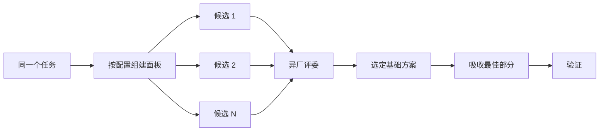

# 写代码前先设计

复杂设计只做一次尝试，往往会把模型的第一种方案固化下来。`/architect` 在实现前确定类型和边界。`/arena` 对同一份简报运行多个候选，再合并最佳部分。`/interrogate` 让其他模型尝试找出结果何时会出错。要做覆盖时，`/pstack-swarm` 将工作拆成分片或并行竞跑，再合并结果。

常见设计错误有两个，直接采用代理的第一种设计，以及反复润色一份从未用代码验证的计划。先用代码规划。原型回答尚未决定的问题，README 或教程设定目标，最后再写计划。


## 用 `/architect` 确定结构

```text
/architect 写代码前先设计导入流程。我最关心调用方如何使用它。
```

[`/architect`](../../skills/architect/SKILL.md) 先追踪变更涉及的所有系统，再草拟两种不同结构，各自给出类型、签名及模块边界。选择每份状态只有一个所有者、每项操作只有一种做法、调用方需要知道最少的一种。设计规模大或有争议时，用 `/arena` 并行出方案。如果你希望写代码前先看设计，在提示词里说清楚。

进入实现后仍可调整设计。同一种变通代码反复出现时，`/architect` 会重新设计。

## 用 `/arena` 并行尝试

```text
/arena 把我的原始提示词逐字交给各席。我想把它们的方案和你的方案一起比较。
```

[`/arena`](../../skills/arena/SKILL.md) 是通用的同题比选工具。N 个子代理并行尝试同一份设计或代码简报，各自在独立 worktree 或目录写入。一名来自不同模型供应商的只读评委按评分标准给所有候选打分。没有可用的异厂模型时，协调者跳过评委，自己选定基础方案。协调者完整读完每个候选，选定一个为基础，吸收其他候选中的最佳想法，再验证结果。



面板来自 [`/setup-pstack`](../../skills/setup-pstack/SKILL.md) 的配置，也可按任务调整。AGY 可以混合 `invoke_subagent` 的原生席和 `run_command` 后台运行的外部 CLI 席。是否跨供应商以实际模型供应商为准。重要决定可以多试几种，影响小的决定少试几种。

```text
/arena 评估这个方案，给我 5 个候选。缓存键格式一旦确定，再改成本很高。
```

## 用 `/pstack-swarm` 覆盖分片和竞跑

```text
/pstack-swarm 对 packages/ 下的每个包运行它自己的 check.sh。每个包一个工作代理，给我一份汇总报告。
```

[`/pstack-swarm`](../../skills/pstack-swarm/SKILL.md) 可将 N 个工作代理分配到独立分片、覆盖矩阵、分组的连环检查、不同探索区域或预先声明的竞跑分支。每个代理拿到自己的范围和检查，最后报告 `PASS`、`ISSUES` 或 `BLOCKED`。父会话等待各代理，再交一份简洁的报告，列出覆盖缺口或掉线的代理。

并行能增加覆盖或让独立方案竞跑时，用 `/pstack-swarm`。做同题设计或代码比选时，用 `/arena`，它给每个工作代理同一份简报，再选一个基础方案、吸收最佳部分。`/pstack-swarm` 按分片检查，或按预先声明的选择规则竞跑。

## 用 `/interrogate` 验证可能的失败

```text
/interrogate 用怀疑的态度审查整个分支。只报真实缺陷或回归。
```

[`/interrogate`](../../skills/interrogate/SKILL.md) 把变更和意图交给按模型配置选出的审查代理，各自在真实代码上尝试使它失败。不同审查者会发现不同故障。只有重跑命令确实出现与意图不符的失败，发现才进入报告。报告列出所有已验证的问题、发现该问题的审查者，以及各审查者撤下的项目和理由。它只交审查结果。

也读 Dropped 清单。你可以推翻结论。

## 用原型验证设计

先比较几个设计，从自己看得到的证据中挑选。

```text
/poteto-mode 为新下拉菜单做几个原型。截图或录下各方案，让我比较。
```

[Prototype playbook](../../skills/poteto-mode/playbooks/prototype.md) 在临时目录里实现用完可丢的草案，把各变体放在同一个切换器后，逐一操作并保存截图或计时。除了界面，也适用于行为和算法。用原型做规划，让代理亲自跑出开放问题的答案，也有机会发现你没想到的办法。

实际设计也能这样做。把 `/architect` 和原型组合起来，保留审阅关口。

```text
/poteto-mode 我们需要为外部 webhook 限流。先用 /architect 定结构，再用原型回答开放问题。让我审完再继续。
```

把审查代理留给有实际代码的变更。`/interrogate` 会撤下运行无法证明的发现。先让原型解决问题，再审查做出来的东西。

## 共享代码先写 README

其他代码要使用的包或 API，可以先写使用者会读的文档。

```text
/poteto-mode 先写教程，说明我该怎么使用新的配置包。再用 /teach 讲清它有哪些优势。
```

先写教程会迫使你站在调用方角度考虑。给假想用户描述 API，再倒推实现。文档也成为代理核对自己工作的具体目标。文档本身重要时，点名 [`/technical-writing`](../../skills/technical-writing/SKILL.md)，让教程保持教程的结构，避免把参考资料和原理说明都塞进去。

## 设计确定后再写计划

pstack 有意把规划放在 playbook 中。需要书面计划时，等设计确定后再要。

```text
/poteto-mode 把这份设计变成计划。拆成可验证的小 PR，每个 PR 有自己的验证步骤。
```

[Multi-phase plan playbook](../../skills/poteto-mode/playbooks/multi-phase-plan.md) 用原型解决剩余问题，然后每个 PR 写一节。每节以改动实际有效的证据收尾，整套测试通过只能作为其中一项证据。本轮交付计划，你同意开始后再执行。

迁移时在提示词中写明验收条件。

```text
/poteto-mode 规划把我们的 UI 库迁移到新的样式系统。拆成可验证的小 PR，每个加入视觉回归检查。结果必须和原版完全一致，包括原有缺陷。
```

「包括原有缺陷」会阻止迁移途中顺手修东西。行为一变，旧输出和新输出就无法直接比较。项目跨多天时，可以临时提交计划，让其他代理看到进行中的工作。全部落地后删掉计划。

## 任务需要多大设计投入

多数小任务不需要这些步骤。可以按下列情况选择。

- 小变更已经做完但你有疑虑，只用 `/interrogate`。
- 变更跨函数边界或转移所有权，用 `/architect`。规模大或有争议时，它会调用 `/arena`。
- 命名、格式或算法等能靠独立尝试改善的单个决定，直接用 `/arena`。
- 覆盖矩阵、并行检查或事先定义分支的竞跑，用 `/pstack-swarm`。
- 布局、耗时和实现方式等可以运行实验回答的问题，用原型。
- 有争议且难以撤回的设计，先 `/architect`，交付前再 `/interrogate`。
- 跨多个 PR 的工作，设计确定后写计划。

`/poteto-mode` 已经按这些情况路由。跨边界的工作会触发 `/architect`。希望增加或减少审查时，再直接调用相应技能。

下一页是[实现变更并清理 diff](./05-build-and-clean.md)。
