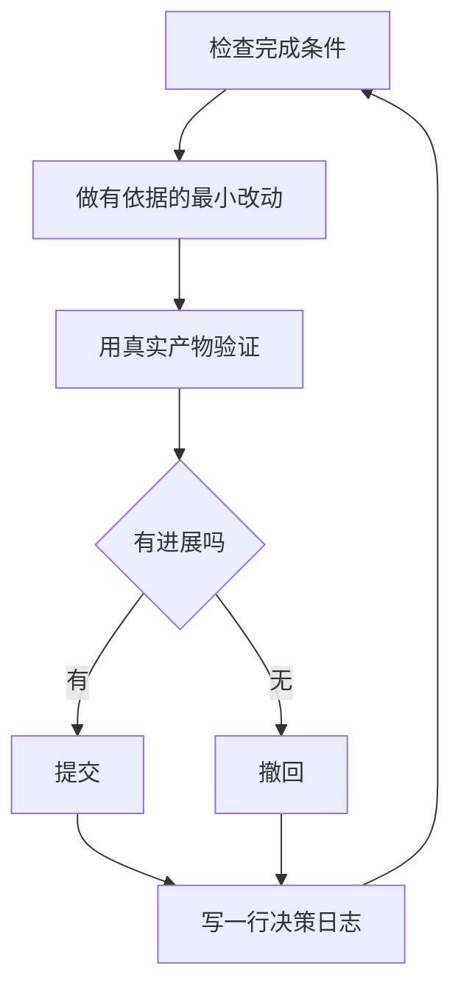

# 离开后继续运行

能自行验证的代理，可以在你离开后继续处理困难任务。交接要有可检查的完成条件、隔离的 worktree 或独立运行环境，以及早上可审计的决策日志。


*上游插图中的 `/loop` 对应 AGY 的 `schedule` 工具或 `/schedule` 命令。*

## 验证可靠后再开启循环

未经验证的循环只会加速产生未经检查的工作，问题每轮叠加。离开前确认以下四项。

- 你亲手做过一遍，或看代理做过，知道好的结果长什么样。
- 代理有你自己会用的工具和信号，包括验证技能、性能分析工具和日志。
- 每个阶段都能证明自己的结果，未达要求时可以中止流程。
- 你读过几份会话记录，并把反复出现的问题做成工具、技能或检查。

四项都满足后再让循环自主运行。之前应在旁观察。

## 无人值守约定

交接时写明目标、完成条件、授权和退出办法。几行就够。

```text
/poteto-mode im going to bed. 从 <基线> 开一个新 worktree，把所有调用方迁到新解析器。
完成条件是旧调用方为零、解析器的全部 fixture 通过、旧 API 已删除。
保留决策日志。提交前不用问我。
用 schedule 定期唤醒，做到完成。如果几小时后确实卡死，停下并写清原因。
```

每行都影响运行方式。

- “im going to bed” 给本次会话增加临时约束，代理自行处理可逆决定，不因日常选择停下调用 `ask_question`。
- 「完成条件是……」将目标变成每轮可运行的检查。
- 「从 `<基线>` 开一个新 worktree」隔离此次运行和其他打开的工作。
- 「提交前不用问我」预先回答了原本会卡住代理的授权问题。
- `schedule` 是 AGY 的定时唤醒机制，由 [Autonomous run playbook](../../skills/poteto-mode/playbooks/autonomous-run.md) 用来在定时检查或事件通知后重新判断完成条件。CI 或命令已有完成通知时，让通知触发检查，定时唤醒作补充。退出条件满足后取消定时任务。
- 写清退出条件，确实走不通时代理就可以停下交代理由，避免八个小时过后把目标改成另一件事。

因为你回来以后还要审查，`/poteto-mode` 将这项工作路由给 [`/figure-it-out`](../../skills/figure-it-out/SKILL.md)。它先设计运行阶段，再动代码，并从一开始就记录决策日志。

需要主动停止时，明确发出暂停或收尾指令，例如「请安全暂停当前任务」。如果只是告知代理你即将离线或重启当前客户端，代理继续执行。[Pause safely playbook](../../skills/poteto-mode/playbooks/pause-safely.md) 会完成或撤回当前一步，经授权可提交进行中的检查点，并写接手说明。新会话通过 Session pickup playbook 从说明处接续。「继续」从不触发暂停。

## 循环每轮做什么



每轮一项改动、一次检查、一行日志。撤掉没有帮助的改动。进度停滞时换办法。完成条件保持原样，直到验收通过或按退出条件报告阻塞。

## 回来审计

[`/show-me-your-work`](../../skills/show-me-your-work/SKILL.md) 让运行可审阅。TSV 每行记录时间、阶段、决定、理由、证据指针和结果。放在 `decisions.tsv`，多轮任务共用目录时放在 `.audit/<task-slug>.tsv`。默认保留在本地。当工作复杂到评审者需要这些记录才足以信任结果时，可提交日志。

回来后用下面的提示词获取审阅结果。

```text
/show-me-your-work 告诉我你昨晚做了什么。
```

技能在交付摘要前安排另一家供应商的模型读日志和会话记录。原生角色用 `invoke_subagent`，需要时用已配置的外部 CLI 启动异厂审阅。回复结尾的「需关注」（Attention）一节会列出值得查看的项目。先读这一节，再读它指向的日志行。审计重点是决定和证据。

只想看状态时，在原会话中用 [`/ketchup`](../../skills/ketchup/SKILL.md)。它只读，用平实文字说明自上条消息以来的变化，并附运行产生的截图和小图。它还会列出等你处理的各项决定，例如合并、批准或选择方案，并给建议、证据和风险，使你只读回复就能决定。

## 整个队列的无人值守执行

上面的约定驱动单项任务走到一组完成条件。也可以处理互相独立的改动队列，或一整个项目计划。两个 playbook 和一个技能可将同样的验证方式用于更大范围。

[Autopilot-full](../../skills/poteto-mode/playbooks/autopilot-full.md) 将独立 PR 队列推进到合并。每个 PR 由一个代理从实现负责到合并，但合并需要独立判定。先用一批新代理验证负责人完成的最新提交。之后的 rebase 或小修再用一名新代理验证。增加新行为或引入大 diff 时，重新派发整批验证。真正要合并的补丁须获得通过结论，才能合并。

```text
/poteto-mode full autopilot on this queue. each item is independent. i want them merged by morning.
```

[Autopilot-stack](../../skills/poteto-mode/playbooks/autopilot-stack.md) 负责实现和验证，到可审阅时停。回来可看到各份 PR 和验证结论，由你审阅并落地。只有依赖先前 PR 的改动才在其上堆叠。希望合并前亲自检查时，选这个流程。

```text
/poteto-mode autopilot these five changes, but don't merge. i'll land them in the morning.
```

横跨多个包的迁移等大型计划没有专用 playbook。`/poteto-mode` 会将这类大型或横跨模块的工作路由到 [`/figure-it-out`](../../skills/figure-it-out/SKILL.md)，由它设计一轮适合的执行与验证。

```text
/poteto-mode 把所有包迁到新的存储模块。负责推进直到每个包都已转换并合并。我每天来看两次。
```

<a id="run-many-projects-in-parallel"></a>

## 并行协调多个项目

在 AGY 中给每个项目保留一个协调会话，集中保存目标、日志和待办，由工作代理实现。先用 `/poteto-mode` 给协调会话下达任务，工作代理按 playbook 执行。每个代理先读 [`worker.md`](../../skills/poteto-mode/worker.md)，遵守启动时约定的验收要求，自行处理可逆决定，按授权准备可审阅的 PR。

原生席用 `invoke_subagent`，按角色配置 `agy:pro`、`agy:flash`、`agy:flash_lite` 或 `agy:inherit`。外部席用 `run_command` 通过 `scripts/multi-model-dispatch.sh` 后台运行 `codex` 或 `pi`。先派外部任务，再发原生批次。每席使用独立工作区或明确的写入范围，外部任务另用独立结果文件。角色来自 `~/.gemini/config/rules/pstack-models.md` 和 `.agents/rules/pstack-models.md`，项目逐角色覆盖。参数见 [AGY 双引擎调度](../harness/antigravity.md#双引擎调度)。

上游 [Cursor Project](https://cursor.com/blog/projects) 把这些工作汇集到一条持久的协调线程。协调者分派子代理，以云端为默认运行环境，合上笔记本后工作仍可继续。AGY 本地运行需要宿主和任务进程保持可用。若确实需要远程运行，另行获得授权并使用已提供的运行环境。

可以用以下方式组织多项工作。

- 每个功能、迁移、性能改进或技术债清理用一个项目或协调会话。多个项目可以并行。
- 在 Cursor Project 里拖入相关聊天，包括已完成的聊天，使它们成为项目内代理的上下文。在 AGY 中，用 `/recall` 或把已授权的记录和决策日志路径写进简报。
- 每个 PR 合并前都先安排一批独立验证，并由 Autopilot-stack 或 Autopilot-full 推进队列。
- 要求协调者给出有数据支持的计划。能用原型回答的问题，先试出答案再提问。

从调查到执行，整个项目可以用一条提示词交接。

```text
/poteto-mode 重构仓库，使代理更容易在里面工作。用 /correct 和 /architect 检查以往提交及评审评论，找出代理最常犯的错误。用 /recall 从过往聊天补上下文。用原型回答可以实验的问题。给我一份有真实数据支持的计划。等我批准后再执行，先问我用 autopilot-stack 还是 autopilot-full。
```

## 让流程自动开始

上述循环仍由你启动。定时或事件驱动的自动化可以省掉这一步。软件维护可拆成适合自动运行的阶段，包括分流报告、复现、修复和验证。两条规则能让各阶段可靠交接。

- 每个阶段都可以中止流程。分流可能确认是预期行为，复现可能失败，修复代理可能判断改动风险过高。这样的结果也有用，可以避免错误流入下一阶段，到那时撤回代价更大。
- 每个阶段都交付证据。复现阶段附错误状态的截图或视频，修复后附前后对比。人可以在读代码前先核实代理修的是正确的问题。

AGY 可对本地周期检查用 `schedule`，已运行的后台任务用完成通知和 `manage_task` 收尾。Slack 事件接入需要相应的连接器和授权。pstack 上游附带一套默认未启用的 [自动化包](https://github.com/cursor/plugins/blob/main/pstack/automations/benny/README.md)，用于处理 Slack 缺陷报告。第一项自动化分流报告，第二项复现已确认的缺陷并可准备小型修复草稿。要在支持的宿主配置它，把 [`FOR_AGENTS.md`](https://github.com/cursor/plugins/blob/main/pstack/automations/benny/FOR_AGENTS.md) 交给代理并指定目标仓库。

**常见陷阱。** 「做四小时」无法作为完成条件。它没有可执行检查，早上只会看到四小时的动作。给 `schedule` 一个可判定通过或失败的条件。

下一页是[用原则名称引导代理](./08-principles.md)。
